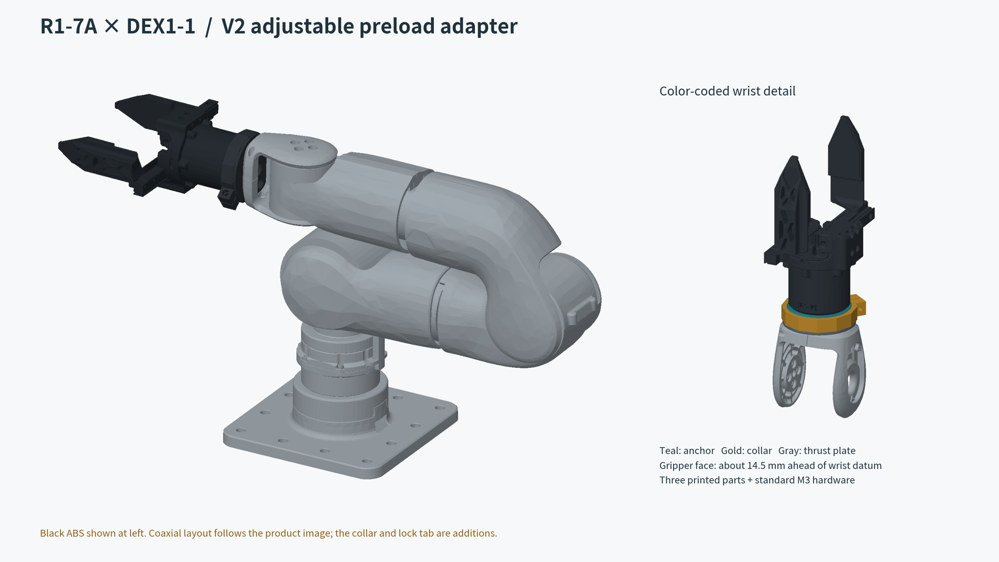

# R1-7A × DEX1-1 ABS 转接环

[English](README.md) · **简体中文**

为 **Unitree 新款独立 R1-7A 机械臂**与 **DEX1-1 夹爪**设计的打印转接件。腕壳合拢后，从外侧旋转压紧环消除轴向自由间隙，再用普通 M3 螺钉锁住压紧环。共三个打印件，无需热熔铜螺母。



**状态：V2 发布候选版。** 已完成 CAD、装配空间和通用切片检查；**尚未验证实物配合、承载能力和 ABS 长期蠕变**。

## 开始使用

1. [下载最新 Release](https://github.com/Black-AI-Inc/Dex1-1-r1-adapter/releases)，获取 STL、3MF、STEP 和源码。
2. 先打印螺纹、腕口与螺钉试片，选择适合自己打印机的配合间隙。
3. 用 ABS 打印下列三个零件，按[中文装配说明](docs/assembly_guide.zh-CN.md)安装。

| 零件 | 打印文件 | 数量 |
|---|---|---|
| 转接主体 | [anchor.stl](print/anchor.stl) | 1 |
| 承压垫环 | [thrust_plate.stl](print/thrust_plate.stl) | 1 |
| 压紧环，默认 C030 | [preload_collar.stl](print/preload_collar.stl) | 1 |

另有较紧的 C020、较松的 C040 压紧环；只需打印选中的一只。单位均为毫米，STL / 3MF 已放好打印方向。

**五金：**5 颗 M3×20 圆柱头内六角螺钉、5 片 M3 平垫片（外径 8、厚 0.5）、1 颗普通 M3 六角螺母（对边 5.5、厚 2.4）。腕壳复用原厂螺钉。见[采购清单与日本供应商示例](docs/bom.csv)。

**参考打印参数：**0.4 mm 喷嘴、0.16 mm 层高、8 层墙、100% 填充。只有主体和腕口试片需要局部支撑。温度使用实际打印机和 ABS 材料配置；不提供可直接执行的 G-code。

## 文档

- [装配、试片选择与实物验收](docs/assembly_guide.zh-CN.md) · [离线 PDF](docs/assembly_guide.zh-CN.pdf)
- [验证范围与结果](docs/validation.md)
- [交互装配预览](docs/assembly_interactive.html)：下载后在浏览器中打开
- [官方来源与归属](NOTICE.md) · [版本变化](CHANGELOG.md)

同轴布置与官方产品图相近，增加了压紧环和局部锁紧耳；夹爪安装面位于腕壳基准面前方约 **14.5 mm**。这是独立设计，并非宇树原厂零件。

## 修改设计

修改 [cad/parameters.json](cad/parameters.json)，然后运行：

```sh
python -m pip install -r cad/requirements.txt
python cad/build_v2.py
python cad/check_v2.py
```

切片、预览与打包方法见[复现说明](docs/reproduce.md)。原创项目文件采用 [MIT 许可证](LICENSE)，官方参考文件保留原许可证。欢迎按[贡献说明](CONTRIBUTING.md)提交实物配合记录与改进。
