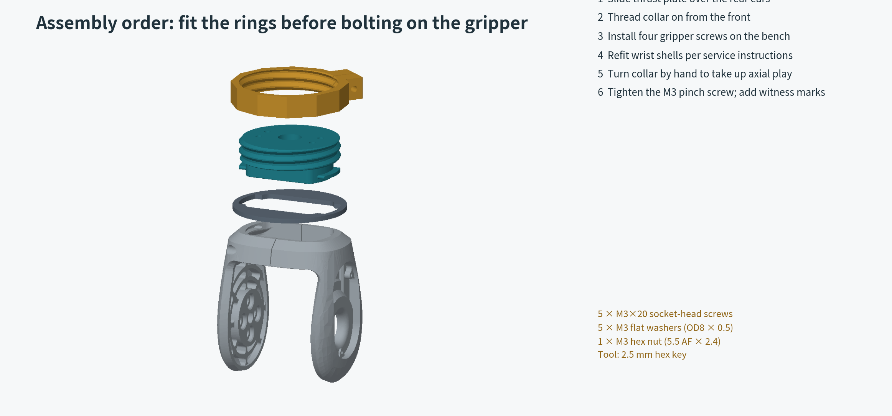

# Assembly and first-fit guide

**English** · [简体中文](assembly_guide.zh-CN.md)

## Compatibility and mechanism

The reference is the standalone R1-7A SDK STEP model pinned in [NOTICE](../NOTICE.md). Its wrist has two shell halves and internal retention grooves. Installation requires opening and refitting those shells according to the manufacturer's service procedure; this repository does not validate disassembly of the actual joint or replace that procedure. Compare your hardware with the reference before opening it.

The DEX1-1 uses the **four inner M3 holes, 10 × 30 mm spacing, drawing depth 8 mm**. The model rotates that pattern 90°, giving X = ±15 and Y = ±5. The other M3 and Ø4 holes are unused. The drawing's Ø49 barrel dimension is not treated as a precision locating spigot.

The collar pushes the thrust plate against the wrist front face while pulling the anchor's ears against the groove shoulders. This takes up axial clearance. Torsional holding depends on the resulting friction; the keyed neck supplies a backup stop. Elastic deflection, slip above the available friction and ABS creep remain possible.

## Print the coupons first

| Coupon | Purpose | Acceptance before full printing |
|---|---|---|
| `thread_male_coupon` + `thread_nut_coupon_C030` | Large printed thread | Turns by hand without forcing, cross-threading or gritty binding |
| C020 / C040 nut coupons | Tighter / looser radial fit | Choose the smallest clearance that turns freely; C030 = 0.30 mm radial allowance |
| `wrist_fit_coupon` | Neck, rounded ears and shell closure | Shells return to their original seating without forcing or changing joint alignment |
| `hardware_coupon` | M3 screw, OD8 washer and ABS bearing seat | Washer seats flat; M3×20 protrudes about 6.5 mm beyond the mating face with its washer installed |

The wrist coupon is an unbolted fit gauge, not an adapter for running the arm. Thread coupons check fit; their single-pitch length does not prove the full collar's strength or freedom from accumulated print error. Check the full-length thread by hand too.

Use the same material, nozzle, layer height, first layer and dimensional compensation for coupons and final parts. The wrist coupon's 1.28 mm face preserves the main part's layer phase at 0.16 mm layers. Do not globally scale the model to fix threads; that also moves the gripper holes and wrist interfaces. Use the alternate collar or adjust the thread parameter instead.

## Print and inspect

- STL and geometry-only 3MF are in millimetres and already oriented. STEP uses assembly coordinates.
- Reference geometry check: 0.4 mm nozzle, 0.16 mm layers, 0.20 mm first layer, 0.45 mm extrusion width, 8 walls, 100% infill, 8 top/bottom layers, 8 mm brim.
- **Anchor:** gripper mating face on the bed. Enable local support under both retaining ears, including support starting on the model. The checked PrusaSlicer setting is snug support, 40° threshold, 0.16 mm contact gap, 0.3 mm XY gap. Do not use build-plate-only support.
- **Collar, thrust plate, thread coupons and hardware coupon:** flat as supplied, without support. The collar's horizontal screw/nut openings require short bridges; confirm their quality with the actual ABS profile.
- Use an enclosure and the material maker's ABS temperatures. The supplied 250/105 °C values are a generic slicing placeholder, not a validated printer recipe.
- Remove brim, elephant-foot ridges and ear support carefully. Leave the mating faces, ears and thread flanks intact. Reject cracks, layer splits, lifted corners or a warped thrust plate. Clean the M3 clearance holes by hand only if necessary; do not tap M3 threads into the ABS.

The three nominal solid parts weigh about **40.9 g** before hardware. The conservative reference slice uses about **43.0 g** including support/brim and estimates about 7 hours; real results depend on the printer. The collar is approximately 60 mm across corners, with a local locking tab extending its overall Y dimension to 67 mm.

## Hardware

Use **5 × M3×20 ISO 4762 / DIN 912 style socket-head screws**, **5 × M3 flat washers, OD8 × ID3.2 × 0.5 mm**, and **1 × ordinary M3 nut, 5.5 mm AF × 2.4 mm thick**. Use a 2.5 mm hex key. Four screws attach the gripper; one pinches the collar. Supplier examples are in [bom.csv](bom.csv). No inserts, spring washers, special spacers or printed M3 threads are required.

The four gripper screws pass through 13.0 mm of plastic plus a 0.5 mm washer, leaving **6.5 mm nominal insertion** into the gripper. The drawing's 8 mm depth leaves 1.5 mm nominal margin, but it does not prove the actual usable thread depth. Measure the real holes and screw projection before tightening. Never use screw torque to pull together a bottomed-out screw or a visibly gapped mounting face.

## Assembly order

1. With the arm powered off and mechanically supported, complete the coupon checks and verify the actual service procedure. Retain the original wrist hardware.
2. Slide the thrust plate onto the anchor **from the rear**, aligning its larger openings with the retaining ears. Its flat rear face will sit on the wrist datum.
3. Thread the chosen collar on **from the gripper side**, with the pinch screw loose and a gap left above the thrust plate. Do this before attaching the gripper.
4. On the bench, put four OD8 washers in the rear counterbores. Install four M3×20 screws into the DEX1-1 metal threads. Start every screw by hand, then tighten evenly while confirming face contact. No validated tightening torque is supplied for printed ABS.
5. Position the ears in the wrist grooves and refit both wrist shell halves with the original hardware and specified service procedure. The digital radial-placement check does not establish real motor alignment, cable routing or an allowed opening distance. Do not force a shell or over-tighten wrist screws to remove play.
6. Seat the thrust plate flat against the wrist front. Back the collar toward the wrist by hand until it takes up the axial gap. Use only enough preload to remove free play; excessive preload can damage the printed ears. Do not use a long wrench to force it.
7. Insert the ordinary M3 nut into the collar's hex pocket. Fit the fifth M3×20 screw with its OD8 washer from the opposite side. Tighten gently to retain the collar setting. A residual split gap is intentional: do not use complete gap closure as a torque target. Check that the nut has not spun or cracked its pocket.
8. Add witness marks across collar/anchor and inspect the cable route. The Ø12 centre passage is reserved space; actual connectors and wiring are not validated. Calibrate the tool frame/TCP for the assembled hardware.

The gripper's rear screws are obstructed by the wrist motor after assembly. Service them by removing the adapter/gripper assembly per the wrist service procedure. The collar pinch screw remains reachable from the side in the checked reference pose.

## Physical acceptance — still pending

Record results in [physical_acceptance.csv](physical_acceptance.csv), including printer, ABS batch, measured fit, selected collar, payload, centre-of-mass distance, acceleration, ambient temperature and tightening method.

1. With power off, reverse a small hand load axially and torsionally. Separate **lost motion** from elastic flexure. Suggested project screening targets—not Unitree specifications—are ≤0.05 mm axial lost motion and ≤0.2 mm reversal lost motion at a 100 mm lever. Any tactile knock, shell gap, nut rotation or witness-mark movement requires correction.
2. Support the gripper during initial static testing. Check its own weight for 30 minutes and again after 24 hours. Record drift, preload loss, cracks and seating changes. ABS creep cannot be cleared by a short test.
3. After that passes, increase the intended task load in 25%, 50% and 100% steps with the real moment arm recorded. A force or moment limit has not been qualified for this design. Stop on slip, increasing flexure or damage.
4. Begin at low speed and acceleration; inspect after 100 cycles, then 1,000 cycles if the earlier stage passes. This is screening, not a fatigue-life certification. Repeat checks at the actual operating temperature and after any re-tightening or material change.

The current digital evidence does not establish a rated payload, safe tightening torque, complete robot motion envelope or permanent zero backlash. Publish measured results with those conditions so others can reproduce them.
