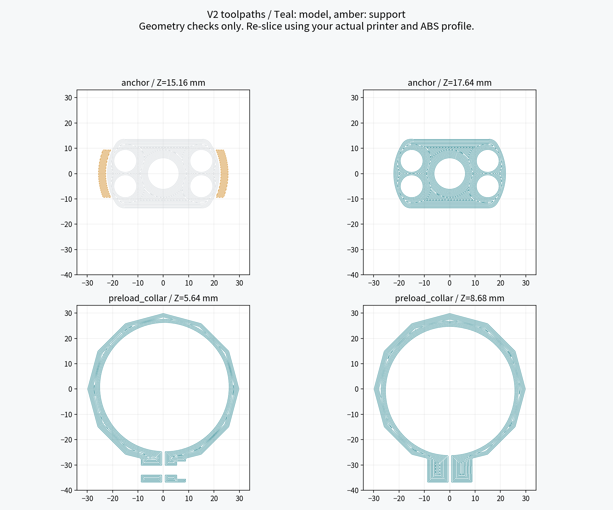

# Validation record — v2.0.0-rc1

The delivered geometry was checked on 2026-10-19. **No physical part has been printed or tested by this project.** Every row in the physical acceptance worksheet remains pending.

| Check | Result | Evidence |
|---|---|---|
| Main CAD / assembly | 270 checks passed | [assembly_validation.json](assembly_validation.json) |
| Alternate threads and coupons | 29 sampled mesh-intersection checks passed | [variant_validation.json](variant_validation.json) |
| Reference arm / gripper envelope | 21 zero-contact samples in the fixed arm pose | [gripper_envelope_validation.json](gripper_envelope_validation.json) |
| Print meshes | 11 valid single solids; closed, consistently oriented STL meshes | [build_validation.json](build_validation.json) |
| Toolpaths | All 11 models sliced; openings, thin webs and required ear supports checked | [slicer_validation.json](slicer_validation.json) |

The main checks include STEP reimport and STL-volume agreement, nominal wrist fit, thread screw-on samples, rear insertion of the thrust plate, radial shell-placement samples, ordinary hardware clearance, bench driver access, side access to the collar screw and clearance against all 17 official arm solids. Thread intersections use Manifold on the exported STL as an independent check on CAD booleans. These are sampled geometric tests, not continuous motion proofs or structural analyses.

The near-seated illustration leaves **0.0133 mm numerical thread clearance** to avoid tangency ambiguity. Analytical nominal flank contact occurs 1° further around the 4.8 mm-pitch thread. The collar is adjusted on the physical hardware; the illustration's angle is not an assembly torque or a prescribed real-world setting. Contact checks show the mechanical load path, not a measured preload.

Approximate contact areas from a 0.005 mm numerical probe are 124 mm² at the thrust plate/wrist, 580 mm² at the collar/plate and 119 mm² at the retaining ears. The gripper screws have 6.5 mm nominal insertion and 1.5 mm remaining drawing depth. The nominal collar has about 2.1 pitches of axial engagement. These are geometry results, not allowable loads or proof of usable thread depth.

The 0.4 mm nozzle / 0.16 mm-layer reference slice preserves both ear supports, the gripper holes, the collar split and the horizontal nut/screw openings. The 1.4 mm webs between counterbores retain at least three crossing paths in the 37 checked layers. The wrist coupon's outer profile follows the main part's layer phase. Actual bridge quality, ABS shrink, layer adhesion and support removal still require printing.

The official simplified model does not establish actual joint service steps, hidden fasteners, motor alignment, cables, connectors or manufacturer tolerances. The gripper envelope check samples finger displacement; it does not sweep the arm's joints. No payload, tightening torque, friction coefficient, fatigue life, temperature rating or sustained zero-backlash claim has been validated. Follow the staged [physical acceptance procedure](assembly_guide.md#physical-acceptance--still-pending).
